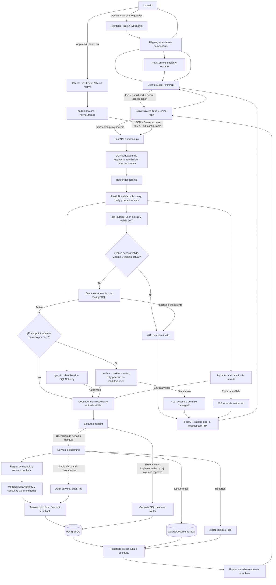
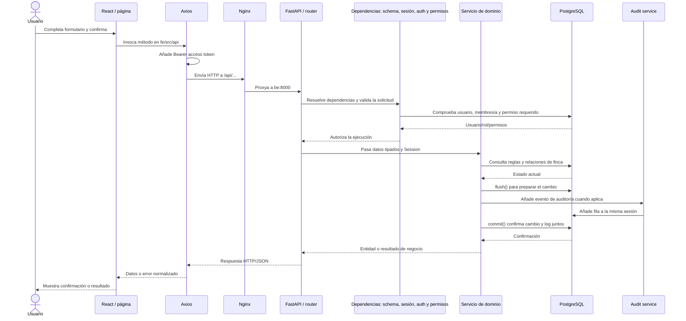
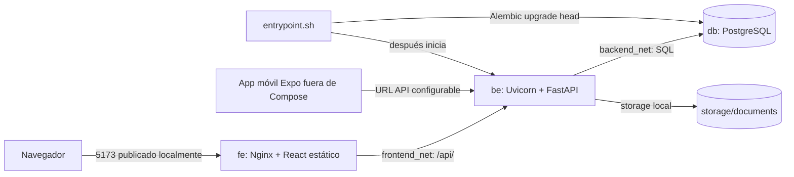

# Diagrama funcional de BoviTrack

Este diagrama muestra cómo una acción del usuario viaja por la aplicación, qué responsabilidad cumple cada capa y dónde se guardan los datos. Está basado en el código actual del repositorio.

## 1. Flujo principal de una petición

> **Nota sobre el diagrama:** representa principalmente una petición protegida. Rutas públicas, como inicio de sesión o registro, omiten las dependencias de usuario autenticado. Autenticación, autorización y validación dependen de la configuración de cada endpoint; no todos requieren el mismo permiso RBAC. Además, varias rutas de reportes ejecutan SQL directamente desde el router en lugar de delegarlo al servicio.

## 2. Responsabilidad de cada etapa

| Etapa | Componentes principales | Responsabilidad |
|---|---|---|
| 1. Interacción | `fe/src/pages`, `fe/src/components` | Presenta pantallas, recoge datos y muestra resultados o errores. No debe ser la autoridad final para permisos ni reglas de negocio. |
| 2. Estado de sesión | `fe/src/context/AuthContext.tsx` | Mantiene usuario, access token y refresh token; inicia sesión, recupera el usuario y limpia la sesión al cerrar o fallar la renovación. |
| 3. Cliente HTTP web | `fe/src/api/axios.ts`, `fe/src/api/*.ts` | Centraliza URLs y llamadas a endpoints. Axios agrega `Authorization: Bearer ...`; al recibir 401 puede renovar el access token y reintentar una vez la llamada original. |
| 3b. Cliente HTTP móvil (opcional) | `mobile/src/services/api.ts`, `authStore.ts` | App Expo separada que usa Axios y `AsyncStorage`, mantiene el token de acceso en memoria, agrega Bearer y puede renovar/reintentar la llamada. Su URL se define en `EXPO_PUBLIC_API_URL`; la app móvil no está declarada como servicio de Docker Compose. |
| 4. Proxy web | `fe/nginx.conf` | Sirve el bundle estático de React; envía solicitudes `/api/` al backend `be:8000`. En este despliegue escucha HTTP; TLS debe terminarse en la infraestructura exterior si se publica en producción. |
| 5. Entrada de API | `be/app/main.py` | Crea FastAPI, registra routers, define CORS, rate limiting y headers, y oculta Swagger/ReDoc cuando `ENVIRONMENT=production`. |
| 6. Enrutamiento HTTP | `be/app/routers/*.py` | Asocia método y ruta con el endpoint. Obtiene parámetros, llama servicios, determina códigos HTTP y prepara respuestas JSON o descargas. |
| 7. Validación de entrada | `be/app/schemas/*.py` y validación de FastAPI | Convierte y valida body, query y path usando tipos Pydantic. Rechaza entradas inválidas antes de que la lógica de negocio las procese. |
| 8. Sesión de persistencia | `be/app/dependencies.py:get_db`, `be/app/database.py` | Crea la sesión SQLAlchemy para la petición y la cierra al terminar, devolviendo la conexión al pool. |
| 9. Identidad | `get_current_user`, `utils/security.py` | Lee el Bearer token, verifica firma/expiración/tipo, identifica al usuario, compara `token_version` y exige que la cuenta siga activa. |
| 10. Permisos y finca | `be/app/permissions.py:require_permission` | En rutas protegidas, comprueba que el usuario sea miembro activo de la finca, que su rol esté habilitado y que tenga la acción solicitada en el módulo. |
| 11. Lógica de dominio | `be/app/services/*_service.py` | Ejecuta reglas propias del negocio, verifica relaciones y pertenencia a finca, consulta o modifica entidades y coordina transacciones. La separación se usa en la mayoría de rutas, con excepciones puntuales. |
| 12. Persistencia relacional | `be/app/models`, SQLAlchemy, PostgreSQL | Define entidades y relaciones; guarda usuarios, fincas, animales, producción, movimientos, tratamientos, datos económicos, auditoría y otros registros. |
| 13. Auditoría | `be/app/services/audit_service.py`, tabla `audit_log` | Registra acciones sobre entidades y permite consultarlas. La atomicidad entre cambio y log depende de cada servicio; se reforzó en bovinos y documentos. |
| 14. Archivos | `document_service.py`, `storage/documents` | Valida formato y tamaño, guarda el archivo fuera de PostgreSQL y almacena en la base de datos su metadata y asociación con finca/entidad. |
| 15. Migraciones y arranque | `be/entrypoint.sh`, Alembic | Aplica `alembic upgrade head` antes de iniciar Uvicorn, para que el esquema de la base de datos corresponda a las migraciones. |
| 16. Respuesta | Router, Pydantic, Axios y UI | Serializa el resultado o archivo, devuelve un código HTTP, convierte los errores conocidos en mensajes y actualiza la pantalla. |

## 3. Servicios de dominio y sus responsabilidades

Los servicios se organizan por capacidades funcionales. El router correspondiente recibe HTTP; el servicio implementa la operación del dominio y usa modelos/repositorios SQLAlchemy cuando necesita persistencia.

| Grupo funcional | Servicios representativos | Responsabilidad funcional |
|---|---|---|
| Acceso y cuenta | `auth_service.py`, `reactivation_service.py`, `invitation_service.py` | Registro e inicio de sesión, tokens, recuperación de contraseña, verificación de correo, invitaciones a fincas y solicitudes de reactivación. |
| Fincas y personal | `farm_service.py`, `employee_service.py` | Crear/consultar fincas y gestionar la relación de usuarios con una finca, su rol y estado de membresía. |
| Hato | `bovine_service.py`, `calf_service.py`, `weight_service.py` | Administrar bovinos, su ciclo de vida, datos de terneros e historial de pesajes. Aplica reglas como unicidad de identificación y coherencia de relaciones. |
| Producción y alimentación | `milk_production_service.py`, `food_service.py` | Registrar y consultar producción de leche, inventario/consumo de alimentos y datos asociados a finca o potrero. |
| Manejo del predio | `land_plot_service.py`, `paddock_service.py`, `movement_service.py` | Gestionar lotes y potreros, su jerarquía dentro de la finca y movimientos de animales. |
| Sanidad y reproducción | `treatment_service.py`, `sanitary_plan_service.py`, `reproductive_event_service.py` | Registrar tratamientos y planes sanitarios, además de eventos reproductivos del hato. |
| Operación y economía | `task_service.py`, `economics_service.py`, `notification_service.py` | Gestionar tareas, registros económicos y notificaciones/alertas usadas por la aplicación. |
| Documentos | `document_service.py` | Validar contenido, guardar/descargar/borrar archivos y mantener metadata, asociación y eventos de auditoría. |
| Reportes y auditoría | `report_service.py`, `audit_service.py` | Agregar métricas y exportar reportes; registrar y consultar eventos de auditoría. Algunas lecturas de vistas se resuelven actualmente en `routers/reports.py`. |

## 4. Secuencia detallada: cambio con auditoría atómica (por ejemplo, un bovino)

Si el servicio encuentra una regla incumplida, lanza un error HTTP y no continúa con la escritura. Si falla una operación dentro de una transacción protegida, se ejecuta `rollback()`. La atomicidad se debe revisar servicio por servicio; no todos siguen todavía el mismo patrón.

## 5. Flujos especiales

### Subida de documento

1. La página adjunta el archivo como `multipart/form-data`.
2. Nginx aplica su límite de cuerpo cuando la petición pasa por el proxy; el endpoint vuelve a limitar la lectura a 50 MiB.
3. El backend reconoce el tipo a partir de la firma/contenido admitido, valida que categoría y extensión coincidan y sanea el nombre.
4. `document_service` comprueba que la entidad asociada pertenezca a la finca.
5. Guarda bytes en `storage/documents` y registra metadata y auditoría en PostgreSQL.
6. Si falla el commit de metadata/auditoría, revierte la sesión y elimina el archivo recién creado.
7. Devuelve metadata al frontend. Para descarga, responde con `Content-Disposition: attachment`.

### Reporte

1. El router valida filtros y permisos de la finca, según el endpoint.
2. `report_service` construye agregados y genera, según se solicite, JSON, Excel o PDF.
3. Las vistas globales permitidas se restringen mediante allowlist y los IDs de finca se pasan como parámetros SQL expansibles.
4. El router devuelve JSON o un archivo adjunto.

### Renovación del access token

1. Axios recibe 401 de una petición protegida, excepto si ya era login o refresh.
2. Envía el refresh token a `/auth/refresh`.
3. Guarda los tokens nuevos en `sessionStorage` y reintenta la petición original una vez.
4. Si falla la renovación, borra los tokens y emite `auth:logout`; `AuthContext` limpia el usuario y la sesión.

## 6. Servicios desplegados con Docker Compose

Docker Compose separa `frontend_net` y `backend_net`: Nginx habla con el backend por la red frontal, y el backend con PostgreSQL por la red de backend. El almacenamiento de documentos mostrado es local al contenedor/directorio montado, no un servicio de objetos externo.

La aplicación móvil no forma parte de estos tres contenedores: se ejecuta por separado y apunta a la URL del backend configurada para el entorno. El contenedor `fe` no tiene acceso directo a PostgreSQL; solo el backend participa en `backend_net`.
