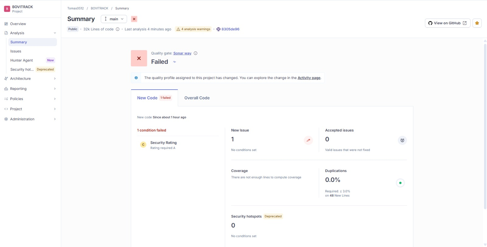
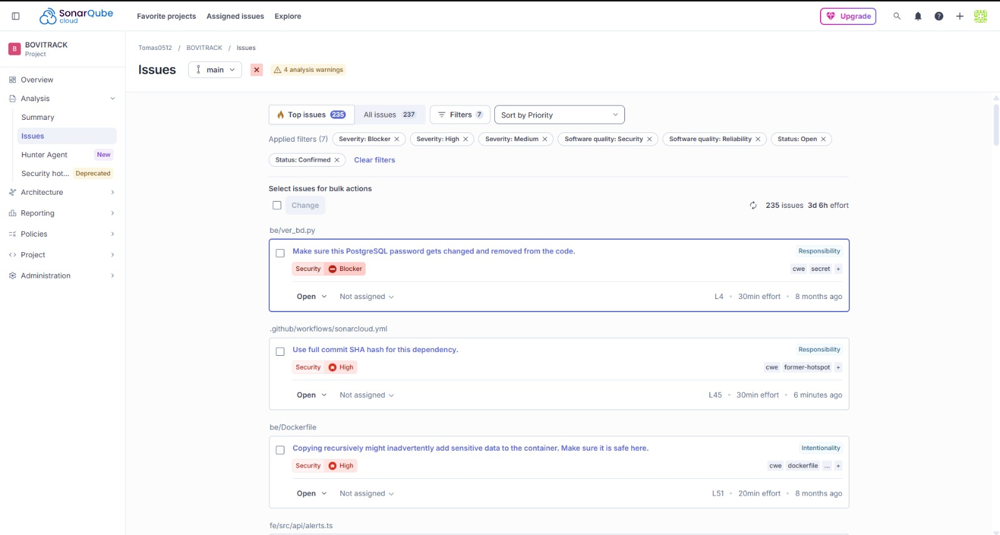
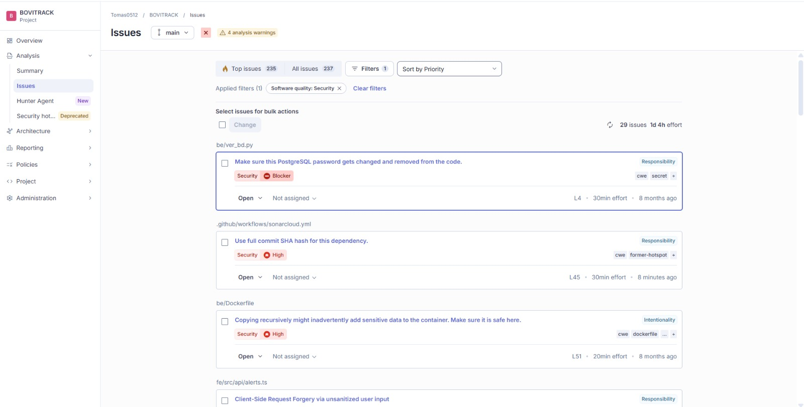

# Informe de Análisis Estático de Código — BoviTrack

## Evidencia individual — Edwin

**Guía de Aprendizaje N.º 08 — Análisis Estático del Código y Calidad de Software**

| | |
|---|---|
| Programa de formación | Análisis y Desarrollo de Software (ADSO) |
| Ficha | 228118 |
| Competencia | Construcción de una solución informática para el control de procesos organizacionales |
| Actividad | AP04 — Construir e integrar módulos de software según requerimientos |
| Aprendiz | **Edwin** |
| Instructor | Cristian González |
| Fecha | 25 de noviembre de 2026 |

| Dato técnico | Valor |
|---|---|
| Proyecto | BOVITRACK |
| Repositorio | https://github.com/Tomas0512/BOVITRACK |
| Herramienta | SonarQube Cloud (SonarCloud) |
| Project key | `BOVITRACK_TOMAS1594` |
| Organización | `tomas0512` |
| Dashboard | https://sonarcloud.io/summary/overall/?id=BOVITRACK_TOMAS1594 |
| Método de análisis | CI-based (GitHub Actions) |

---

## 1. Aporte individual

Me correspondieron las vulnerabilidades del **backend y la imagen de
contenedor**: credenciales en código versionado, generación de valores
aleatorios y permisos dentro de la imagen de producción.

| # | Severidad | Regla | Archivo | Issues |
|---|---|---|---|---:|
| **V6** | MAJOR | `python:S2068` | `qa_e2e/config.py` | 2 |
| **V7** | MAJOR | `python:S2245` | `be/seed_test_data.py` | 10 |
| **V9** | MINOR | `docker:S6504` | `be/Dockerfile` | 1 |

**13 issues en total**, el bloque más numeroso del reparto.

V9 tiene una particularidad que vale la pena destacar: **no estaba en la línea
base**. Lo introdujo la corrección de otro hallazgo y lo detectó el análisis
continuo. La sección 5 lo explica.

---

## 2. Escaneo inicial: línea base

Análisis del commit `8305de9`, 25/11/2026 02:06 UTC. Estado **antes** de
cualquier refactorización.



*Figura 1 — Quality Gate **Failed** sobre el commit `8305de96`.*



*Figura 2 — **237 issues**, esfuerzo estimado **3 días y 6 horas**.*



*Figura 3 — Filtro **Security**: **29 issues**, esfuerzo **1 día y 4 horas**.*

| Métrica | Valor | Calificación |
|---|---|---|
| Quality Gate | **Failed** | — |
| Seguridad | 29 issues | **E** |
| Fiabilidad | 208 issues | **C** |
| Mantenibilidad | 39 issues | **A** |
| Líneas de código | 32 373 | — |
| Cobertura | 0.0 % | — |
| Duplicación | 2.9 % | — |

**Distribución de las 29 vulnerabilidades por área:**

| Área | Vulnerabilidades |
|---|---:|
| `be/seed_test_data.py` | **10** |
| `fe/src` | 7 |
| `be/Dockerfile` | 6 |
| `qa_e2e/config.py` | **2** |
| `fe/Dockerfile` | 2 |
| `db/Dockerfile` | 1 |
| `be/ver_bd.py` | 1 |

Un solo archivo, `be/seed_test_data.py`, concentraba **el 34 % de todas las
vulnerabilidades del proyecto**.

---

## 3. Matriz de mis hallazgos

| # | Tipo | Severidad | Regla | Archivo | Línea | Descripción | Esfuerzo |
|---|---|---|---|---|---|---|---|
| V6 | Vulnerabilidad | **MAJOR** ×2 | `python:S2068` | `qa_e2e/config.py` | 34, 39 | `TEST_PASSWORD` e `INVALID_PASSWORD` en texto plano en un archivo versionado de un repositorio público. | 30 min c/u |
| V7 | Vulnerabilidad | **MAJOR** ×10 | `python:S2245` | `be/seed_test_data.py` | 371, 436, 549 y 7 más | Uso del generador pseudoaleatorio `random`, no criptográfico, en 10 puntos del script de datos semilla. | 10 min c/u |
| V9 | Vulnerabilidad | **MINOR** | `docker:S6504` | `be/Dockerfile` | 62 | El código se copia a la imagen con `--chown=appuser`, de modo que el propio usuario de ejecución puede reescribir la aplicación. | 20 min |

---

## 4. Refactorización: antes y después

### V6 — Contraseñas en un archivo versionado

**Antes** — `qa_e2e/config.py:34, 39`

```python
TEST_EMAIL = "admin@bovitrack.com"
TEST_PASSWORD = "Demo1234!"

INVALID_EMAIL = "usuario_no_existe@bovitrack.com"
INVALID_PASSWORD = "ClaveIncorrecta123!"
```

**Después**

```python
import os
import secrets

TEST_EMAIL = os.environ.get("E2E_TEST_EMAIL", "admin@bovitrack.com")
TEST_PASSWORD = os.environ.get("E2E_TEST_PASSWORD")

INVALID_EMAIL = "usuario_no_existe@bovitrack.com"
INVALID_PASSWORD = os.environ.get("E2E_INVALID_PASSWORD") or secrets.token_urlsafe(24)

if not TEST_PASSWORD:
    raise RuntimeError(
        "Falta la variable de entorno E2E_TEST_PASSWORD.\n"
        "Es la clave del usuario demo que crea be/seed_test_data.py.\n"
        "Ejemplo:  E2E_TEST_PASSWORD='...' python run_all_tests.py"
    )
```

**Criterio.** Tres decisiones:

- **Falla temprano y explica.** Sin la variable, la suite se detiene al
  arrancar con un mensaje claro, en vez de fallar treinta pruebas después con
  un login rechazado y sin pista de la causa.
- **La clave inválida también sale del código.** En un primer intento la dejé
  con un literal por defecto (`"clave-invalida-para-pruebas"`) y **SonarCloud
  la volvió a marcar**: la regla no distingue una clave falsa de una real,
  porque no puede. Generarla con `secrets.token_urlsafe(24)` elimina el literal
  y además **garantiza** que no coincide con ninguna contraseña real de la base
  de pruebas, que es justamente lo que el caso de prueba negativo necesita.
- **Se documentó el contrato.** `qa_e2e/README.md` lleva ahora una tabla con
  las tres variables, cuál es obligatoria y un ejemplo de ejecución.

> **Importante para el equipo.** Quitar la contraseña del archivo **no la borra
> del historial de Git**: sigue siendo recuperable en los commits anteriores.
> Por eso la credencial del usuario demo debe considerarse comprometida y
> rotarse en la base de datos de pruebas.

### V7 — Generador pseudoaleatorio no criptográfico

**Antes** — `be/seed_test_data.py`, con `import random` repetido dentro de 6 funciones

```python
def _crear_tratamientos(...):
    import random
    ...
    t_type, product, dose, route, obs = random.choice(treatment_templates)
    app_date = ref_date - timedelta(days=random.randint(15, 180))
```

**Después** — una única instancia a nivel de módulo

```python
import random
...
from app.services.audit_service import add_audit_log

# What?    Generador aleatorio respaldado por la fuente de entropia del
#           sistema operativo (os.urandom), en lugar del Mersenne Twister
#           global del modulo random.
# ¿Para?   El Mersenne Twister es predecible: observando suficientes salidas
#           se puede reconstruir su estado interno y anticipar las
#           siguientes. SystemRandom no es reproducible de esa forma.
# Impact?  Los datos de este script son de demostracion, pero mantener un
#           unico generador seguro evita que el patron se copie a un
#           contexto donde si importe (tokens, contrasenas temporales,
#           identificadores). El costo es nulo.
_rng = random.SystemRandom()
```

```python
t_type, product, dose, route, obs = _rng.choice(treatment_templates)
app_date = ref_date - timedelta(days=_rng.randint(15, 180))
```

**Criterio.** Aquí hay un matiz que conviene argumentar, porque un evaluador
puede preguntarlo: **¿es realmente una vulnerabilidad generar datos de
demostración con `random`?** En este script concreto, no: los pesos y las
fechas de los bovinos de prueba no protegen nada.

Se corrigió igualmente por dos razones:

1. **`SystemRandom` tiene exactamente la misma interfaz y un costo
   despreciable** en un script que se ejecuta una vez. No hay razón para
   preferir el generador débil.
2. **El patrón se copia.** Un archivo del repositorio que usa `random` para
   generar valores es el modelo que alguien tomará el día que necesite un token
   de recuperación o una contraseña temporal. Mantener un único generador
   seguro elimina ese riesgo de raíz.

La alternativa legítima habría sido marcar los 10 issues como *Safe* con
justificación escrita. Se prefirió corregir porque el costo era nulo.

Se aprovechó además para **eliminar los 6 `import random` repetidos dentro de
funciones** y dejar una sola importación a nivel de módulo, colocada después
del bloque de importaciones para no romper el orden que exige PEP 8.

### V9 — El código de la aplicación era escribible por el usuario de ejecución

**Antes** — `be/Dockerfile:60-62`

```dockerfile
COPY --chown=appuser:appgroup app ./app
COPY --chown=appuser:appgroup alembic ./alembic
COPY --chown=appuser:appgroup alembic.ini entrypoint.sh ./

RUN mkdir -p /app/storage/documents && chown -R appuser:appgroup /app/storage
```

**Después**

```dockerfile
# El código se copia SIN --chown, de modo que queda propiedad de root y
# appuser solo puede leerlo. Si appuser fuese el dueño, un atacante que
# lograse ejecución con ese usuario podría reescribir la aplicación y
# persistir dentro del contenedor.
COPY app ./app
COPY alembic ./alembic
COPY alembic.ini entrypoint.sh ./

# El único directorio escribible es el de documentos subidos: es el que sí
# necesita pertenecer a appuser.
RUN mkdir -p /app/storage/documents && chown -R appuser:appgroup /app/storage
```

**Criterio.** Este hallazgo **no existía en la línea base**: lo introdujo la
corrección de V2 (otro integrante), que sustituyó `COPY . .` por copias
explícitas manteniendo `--chown=appuser:appgroup`. El análisis continuo lo
detectó en el commit siguiente.

El razonamiento de seguridad es el **principio de mínimo privilegio** llevado
un paso más allá de lo habitual. No basta con que la aplicación no corra como
root: si el usuario de ejecución es además **dueño** del código, un atacante
que logre ejecución con ese usuario puede reescribir la aplicación y persistir
entre reinicios del contenedor. Dejando el código como propiedad de `root` en
solo lectura, el contenedor comprometido se limpia al recrearse.

Hubo que comprobar que la aplicación **no necesita escribir en `/app`**: el
único directorio escribible es `/app/storage/documents`, que conserva su
`chown` porque ahí se guardan los documentos que suben los usuarios. También se
verificó que `entrypoint.sh` no requiere permiso de ejecución, porque se
invoca como `CMD ["sh", "entrypoint.sh"]`.

---

## 5. Verificación ejecutada

**Permisos dentro de la imagen construida** — la comprobación clave de V9:

```
$ docker run --rm --entrypoint sh bovitrack-be -c "ls -ld /app/app /app/storage && id && touch /app/app/x"

drwxr-xr-x 8 root    root     4096 /app/app
drwxr-xr-x 3 appuser appgroup 4096 /app/storage
uid=100(appuser) gid=101(appgroup)
touch: cannot touch '/app/app/x': Permission denied     ← correcto
```

```
$ docker run --rm --entrypoint sh bovitrack-be -c "touch /app/storage/documents/x"
(sin error)                                              ← correcto
```

**Resto de comprobaciones:**

| Comprobación | Resultado |
|---|---|
| `docker build` del backend | correcto |
| `import app.main` dentro de la imagen | OK |
| `python -m py_compile seed_test_data.py ver_bd.py` | correcto |
| `_rng` definido antes de su primer uso (AST) | `['_rng', 'DATABASE_URL', 'engine']` |
| `qa_e2e/config.py` **sin** `E2E_TEST_PASSWORD` | aborta con el mensaje esperado |
| `qa_e2e/config.py` **con** la variable | carga; `INVALID_PASSWORD` de 32 caracteres |

La comprobación del orden de definición de `_rng` se hizo recorriendo el árbol
sintáctico del módulo, porque mover una asignación a nivel de módulo puede
dejarla **después** de su primer uso y eso solo falla en tiempo de ejecución.

---

## 6. Impacto medido

| Métrica | Antes (`0149226`) | Después (`b20ed93`) | Variación |
|---|---:|---:|---|
| Vulnerabilidades totales del proyecto | 27 | **9** | −18 (equipo) |
| **Mis 13 issues** | 13 abiertos | **0 abiertos** | **−13** |
| `python:S2068` | 2 | **0** | cerrada |
| `python:S2245` | 10 | **0** | cerrada |
| `docker:S6504` | 1 | **0** | cerrada |
| Esfuerzo de remediación de seguridad | 660 min | **360 min** | **−300 min** |
| **Security Rating sobre código nuevo** | C | **A** | **▲** |

De las 18 vulnerabilidades que cerró el equipo en esta fase, **13 corresponden
a este bloque**. El archivo `be/seed_test_data.py` pasó de ser el que más
vulnerabilidades tenía del proyecto a no tener ninguna.

Las tres reglas quedaron con **0 issues abiertos**, verificado vía API de
SonarCloud.

---

## 7. Conclusiones

1. **Una corrección también es código, y también se audita.** V9 nació de
   arreglar V2. Sin análisis en cada commit, ese retroceso habría quedado en el
   repositorio sin que nadie lo notara.
2. **Sacar un secreto del código no lo saca del historial.** La contraseña del
   usuario demo sigue siendo recuperable en los commits anteriores y debe
   rotarse. La corrección evita el daño futuro, no el pasado.
3. **El análisis estático no distingue una clave falsa de una real**, y hace
   bien: no puede. Por eso el literal de la contraseña inválida volvió a
   aparecer marcado hasta que se generó en tiempo de ejecución.
4. **No todo hallazgo es un riesgo real en su contexto**, pero corregirlo
   igualmente tiene valor cuando el costo es nulo: lo que se evita es que el
   patrón débil se propague a donde sí importa.

---

## 8. Trazabilidad

| Commit | Contenido |
|---|---|
| `8aca716` | Corrección de V7, V9 y primer intento de V6 |
| `b20ed93` | Cierre definitivo de V6 sin literal de clave |
