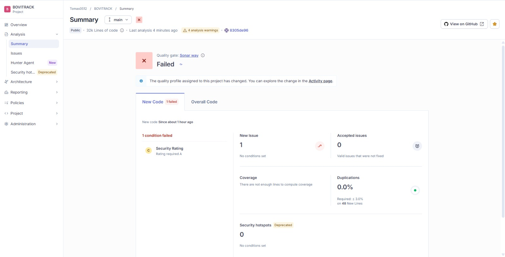
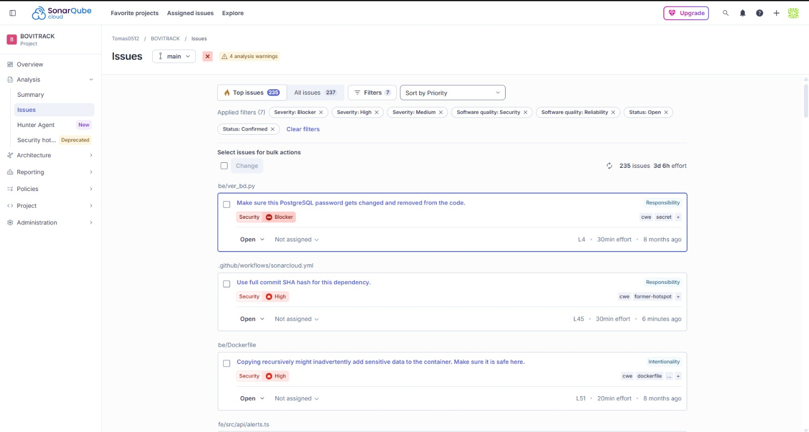
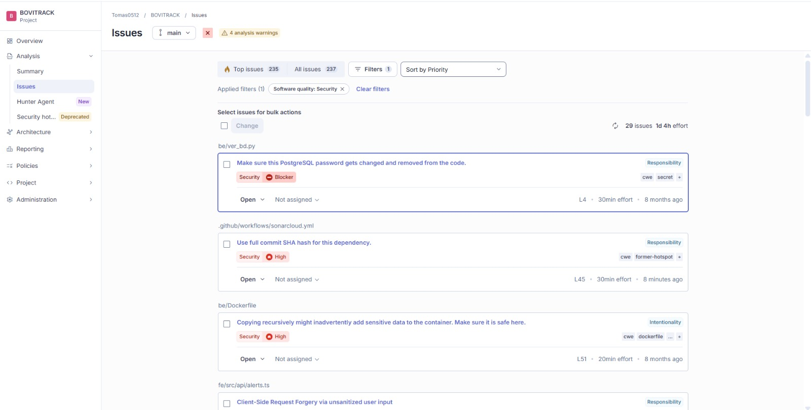

# Informe de Análisis Estático de Código — BoviTrack

## Evidencia individual — Tomás

**Guía de Aprendizaje N.º 08 — Análisis Estático del Código y Calidad de Software**

| | |
|---|---|
| Programa de formación | Análisis y Desarrollo de Software (ADSO) |
| Ficha | 228118 |
| Competencia | Construcción de una solución informática para el control de procesos organizacionales |
| Actividad | AP04 — Construir e integrar módulos de software según requerimientos |
| Aprendiz | **Tomás** |
| Instructor | Cristian González |
| Fecha | 25 de noviembre de 2026 |

| Dato técnico | Valor |
|---|---|
| Proyecto | BOVITRACK |
| Repositorio | https://github.com/Tomas0512/BOVITRACK |
| Herramienta | SonarQube Cloud (SonarCloud) |
| Project key | `BOVITRACK_TOMAS1594` |
| Organización | `tomas0512` |
| Dashboard | https://sonarcloud.io/summary/overall/?id=BOVITRACK_TOMAS1594 |
| Método de análisis | CI-based (GitHub Actions) |

---

## 1. Aporte individual

Me correspondió la **seguridad del frontend**: las tres vulnerabilidades en que
un valor de origen no confiable llega a decidir a qué recurso apunta una
petición o qué se persiste en el navegador.

| # | Severidad | Regla | Archivo |
|---|---|---|---|
| **V3** | MAJOR | `tssecurity:S7044` | `fe/src/api/alerts.ts` |
| **V4** | MINOR | `tssecurity:S8476` | `fe/src/api/alerts.ts` |
| **V5** | MINOR | `tssecurity:S8475` | `fe/src/context/FarmContext.tsx` |

Las tres pertenecen a la misma familia —**entrada no saneada**— y por eso se
resolvieron con una sola estrategia común, descrita en la sección 5.

---

## 2. Qué es el análisis estático y qué aporta aquí

El análisis estático inspecciona el código **sin ejecutarlo**: recorre su
estructura y aplica reglas. Las tres vulnerabilidades de esta evidencia
proceden del motor de **análisis de contaminación (*taint analysis*)**, que es
la parte más interesante de la técnica: SonarCloud no busca un patrón de texto,
sino que **sigue el recorrido de un dato** desde su punto de entrada (una
fuente que el usuario controla) hasta un punto sensible (el *sink*), y avisa si
en el camino nadie lo validó.

Por eso estos hallazgos no se habrían encontrado leyendo una línea aislada:
hace falta seguir el flujo entre archivos.

---

## 3. Escaneo inicial: línea base

Análisis del commit `8305de9`, 25/11/2026 02:06 UTC. Estado **antes** de
cualquier refactorización.



*Figura 1 — Quality Gate **Failed** sobre el commit `8305de96`.*



*Figura 2 — **237 issues**, esfuerzo estimado **3 días y 6 horas**.*



*Figura 3 — Filtro **Security**: **29 issues**, esfuerzo **1 día y 4 horas**.
Al final de la captura aparece el *Client-Side Request Forgery* de
`fe/src/api/alerts.ts`, uno de mis hallazgos.*

| Métrica | Valor | Calificación |
|---|---|---|
| Quality Gate | **Failed** | — |
| Seguridad | 29 issues | **E** |
| Fiabilidad | 208 issues | **C** |
| Mantenibilidad | 39 issues | **A** |
| Líneas de código | 32 373 | — |
| Cobertura | 0.0 % | — |
| Duplicación | 2.9 % | — |

De los 29 issues de seguridad, **7 estaban en `fe/src`**, y los 5 que me
corresponden son todos de *taint analysis*.

---

## 4. Matriz de mis hallazgos

| # | Tipo | Severidad | Regla | Archivo | Línea | Descripción | Esfuerzo |
|---|---|---|---|---|---|---|---|
| V3 | Vulnerabilidad | **MAJOR** ×2 | `tssecurity:S7044` | `fe/src/api/alerts.ts` | 120, 130 | *API Traversal*: `farmId` y `notificationId` se interpolan sin validar en la ruta de la petición. Un valor con `../` permite alcanzar un endpoint distinto del previsto. | 30 min c/u |
| V4 | Vulnerabilidad | **MINOR** ×2 | `tssecurity:S8476` | `fe/src/api/alerts.ts` | 120, 130 | *Client-Side Request Forgery*: sobre las mismas dos líneas, entrada no saneada que determina el destino de la petición. | 20 min c/u |
| V5 | Vulnerabilidad | **MINOR** | `tssecurity:S8475` | `fe/src/context/FarmContext.tsx` | 39 | *Browser Storage Poisoning*: `localStorage.setItem(STORAGE_KEY, id)` persiste un identificador sin validar que después se reutiliza como `farmId` en las llamadas a la API. | 20 min |

**Total: 5 issues abiertos.**

---

## 5. Refactorización: antes y después

### Primer intento, y por qué no bastó

La reacción inmediata ante una interpolación en una URL es codificarla:

```ts
`/farms/${encodeURIComponent(farmId)}/alerts/history/unread-count`
```

Eso **cerró V3** (`S7044`, API Traversal), porque `encodeURIComponent` escapa
las barras y los `..` y ya no se puede salir de la ruta prevista.

Pero **V4 siguió abierta** en el análisis siguiente, y el motivo es
conceptualmente importante: *Client-Side Request Forgery* no trata de romper la
sintaxis de la URL, sino de que **el destino de la petición lo decida un valor
que el usuario controla**. Codificar no cambia quién decide. Un `farmId`
manipulado sigue siendo un `farmId` válido sintácticamente que apunta a otra
finca.

La corrección correcta no es escapar, es **validar contra una lista blanca**.

### Solución definitiva — nuevo módulo `fe/src/api/pathParams.ts`

```ts
// Patrón de longitud fija y sin alternativas: no tiene retroceso
// (backtracking), por lo que no es vulnerable a ReDoS.
const UUID_PATTERN =
  /^[0-9a-fA-F]{8}-[0-9a-fA-F]{4}-[0-9a-fA-F]{4}-[0-9a-fA-F]{4}-[0-9a-fA-F]{12}$/;

export function uuidPathSegment(value: string, paramName: string): string {
  if (!UUID_PATTERN.test(value)) {
    throw new Error(
      `El parámetro "${paramName}" no es un identificador válido.`,
    );
  }
  return encodeURIComponent(value);
}

export { UUID_PATTERN };
```

### V3 y V4 — `fe/src/api/alerts.ts`

**Antes**

```ts
export async function getUnreadNotificationCount(
  farmId: string,
): Promise<UnreadCount> {
  const res = await api.get<UnreadCount>(
    `/farms/${farmId}/alerts/history/unread-count`,
  );
  return res.data;
}

export async function markNotificationRead(
  farmId: string,
  notificationId: string,
): Promise<void> {
  await api.put(`/farms/${farmId}/alerts/history/${notificationId}/read`);
}
```

**Después**

```ts
import { uuidPathSegment } from "./pathParams";

export async function getUnreadNotificationCount(
  farmId: string,
): Promise<UnreadCount> {
  const res = await api.get<UnreadCount>(
    `/farms/${uuidPathSegment(farmId, "farmId")}/alerts/history/unread-count`,
  );
  return res.data;
}

export async function markNotificationRead(
  farmId: string,
  notificationId: string,
): Promise<void> {
  await api.put(
    `/farms/${uuidPathSegment(farmId, "farmId")}/alerts/history/${uuidPathSegment(notificationId, "notificationId")}/read`,
  );
}
```

**Criterio.** Dos decisiones:

- **Se corrigieron los 6 puntos del archivo, no solo los 2 marcados.** Sonar
  señaló las líneas 120 y 130 porque son las que su motor logró rastrear hasta
  una fuente controlable, pero las otras cuatro interpolan el mismo `farmId`.
  Corregir únicamente lo marcado deja el archivo inconsistente y el próximo
  cambio reintroduce el problema.
- **La validación falla cerrada**: lanza en lugar de emitir una petición a una
  ruta imprevista. Antes de elegir esto comprobé en `be/app/models/farm.py` que
  los identificadores de BoviTrack son `UUID(as_uuid=True)` en la base de
  datos, de modo que ningún valor legítimo puede ser rechazado.

### V5 — `fe/src/context/FarmContext.tsx`

**Antes**

```ts
const [activeFarmId, setActiveFarmIdState] = useState<string | null>(
  () => localStorage.getItem(STORAGE_KEY)
);

const setActiveFarmId = useCallback((id: string) => {
  setActiveFarmIdState(id);
  localStorage.setItem(STORAGE_KEY, id);
}, []);
```

**Después**

```ts
import { UUID_PATTERN } from "../api/pathParams";

function readStoredFarmId(): string | null {
  const stored = localStorage.getItem(STORAGE_KEY);
  if (stored && UUID_PATTERN.test(stored)) return stored;
  // Valor ausente o manipulado: se descarta y se limpia.
  if (stored) localStorage.removeItem(STORAGE_KEY);
  return null;
}

const [activeFarmId, setActiveFarmIdState] = useState<string | null>(
  readStoredFarmId
);

const setActiveFarmId = useCallback((id: string) => {
  // Solo se persisten identificadores con forma de UUID: lo que se guarda
  // aquí se reutiliza después como `farmId` en las rutas de la API.
  if (!UUID_PATTERN.test(id)) return;
  setActiveFarmIdState(id);
  localStorage.setItem(STORAGE_KEY, id);
}, []);
```

**Criterio.** Se valida **en los dos extremos**, y la lectura es la que
realmente importa: `localStorage` es escribible por cualquier script que corra
en el origen y **persiste entre sesiones**, así que el valor envenenado puede
haber sido plantado mucho antes. Un valor que no pasa la validación se descarta
y se limpia del almacenamiento.

El patrón se importa del módulo `pathParams.ts` en lugar de declarar una copia,
para que el criterio de "identificador válido" sea **único en toda la
aplicación**: si mañana cambia el formato de los identificadores, se cambia en
un solo sitio.

---

## 6. Verificación ejecutada

Sobre la etapa *builder* de `fe/Dockerfile`, que instala las dependencias con
el lockfile exacto:

| Comprobación | Resultado |
|---|---|
| `pnpm build` (tsc + Vite) | correcto |
| `pnpm lint` (ESLint) | 7 problemas (4 errores, 3 avisos) |
| `pnpm test` (Vitest) | **43 pruebas, 43 pasan** |

Los 7 problemas de ESLint son **preexistentes**: se ejecutó el mismo linter
sobre `main` sin estos cambios y el resultado fue idéntico. Ninguno afecta a
los archivos modificados.

Las pruebas de `NotificationBell` y `MapaInteractivoFinca`, que son las que
ejercitan el módulo de alertas, siguen pasando.

---

## 7. Impacto medido

| Métrica | Antes (`0149226`) | Después (`b20ed93`) | Variación |
|---|---:|---:|---|
| Vulnerabilidades totales del proyecto | 27 | **9** | −18 (equipo) |
| **Mis 5 issues** | 5 abiertos | **0 abiertos** | **−5** |
| `tssecurity:S7044` | 2 | **0** | cerrada |
| `tssecurity:S8476` | 2 | **0** | cerrada |
| `tssecurity:S8475` | 1 | **0** | cerrada |
| **Security Rating sobre código nuevo** | C | **A** | **▲** |

Tras esta iteración y la de Edwin, **`fe/src` dejó de tener vulnerabilidades**
y la condición *Security Rating on New Code* del Quality Gate pasó de fallar a
cumplirse con calificación **A**.

Las tres reglas quedaron con **0 issues abiertos**, verificado vía API de
SonarCloud.

---

## 8. Conclusiones

1. **Cerrar una regla no es lo mismo que resolver el problema.**
   `encodeURIComponent` cerró V3 y dejó V4 abierta. La herramienta distinguió
   dos riesgos que a simple vista parecían uno solo: romper la ruta y decidir
   el destino.
2. **Escapar y validar no son intercambiables.** Escapar neutraliza caracteres;
   validar contra una lista blanca decide qué valores existen. Para que un dato
   no elija el recurso al que se apunta, hay que validar.
3. **Verificar el dominio antes de validar.** Comprobar en el modelo del
   backend que los identificadores son UUID fue lo que permitió exigir ese
   formato sin riesgo de rechazar datos legítimos.
4. **El análisis de contaminación ve lo que una revisión línea a línea no ve**,
   porque sigue el dato entre archivos: de `localStorage` al contexto de React,
   del contexto a la función de API y de ahí a la URL.

---

## 9. Trazabilidad

| Commit | Contenido |
|---|---|
| `8aca716` | Corrección de V3 y V5 (primer intento de V4) |
| `b20ed93` | Cierre definitivo de V4 con validación de formato |
